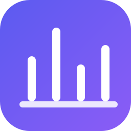
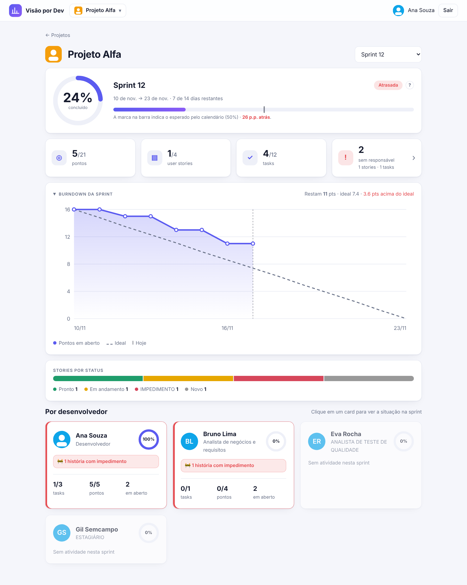
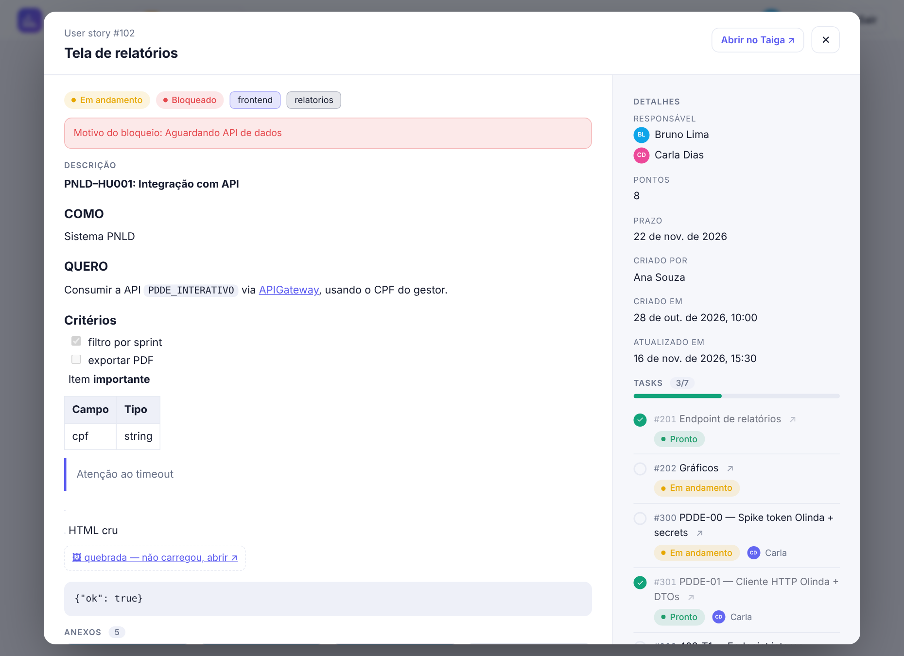
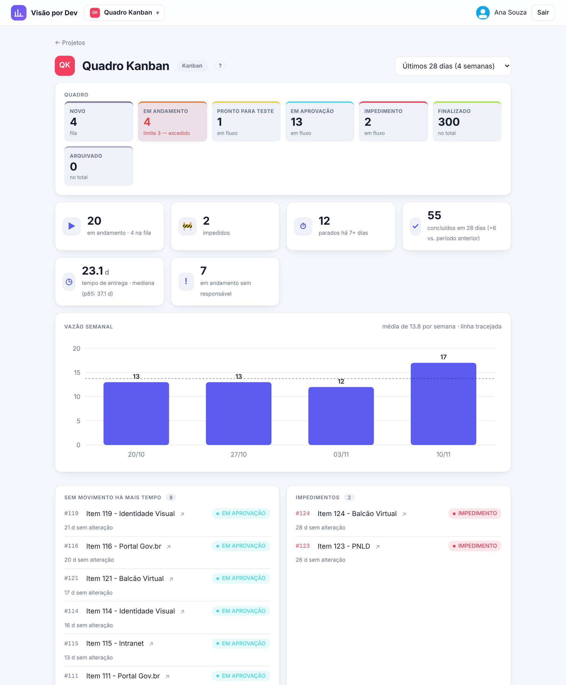
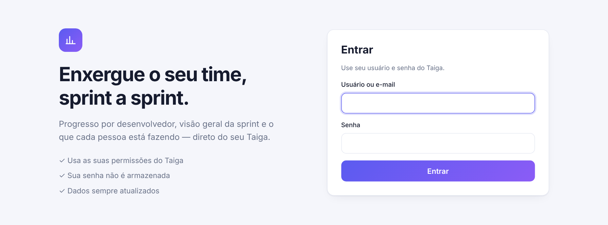
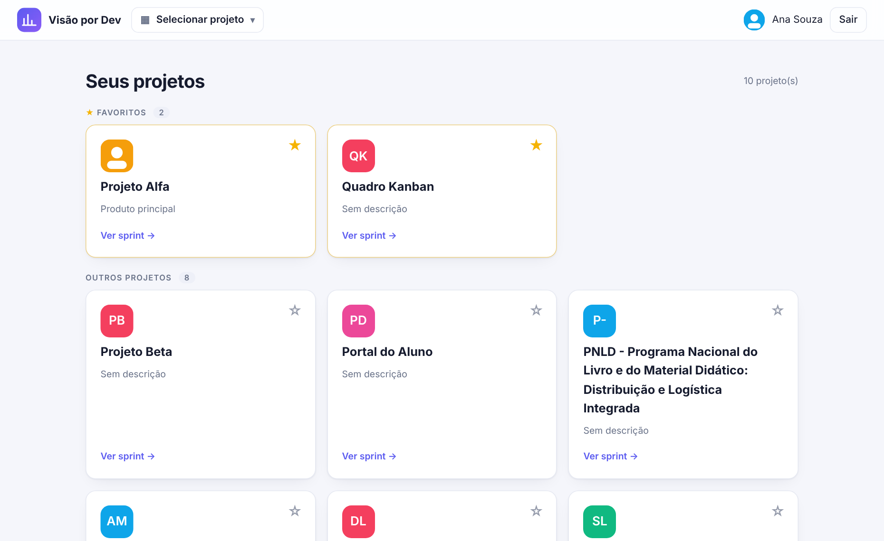
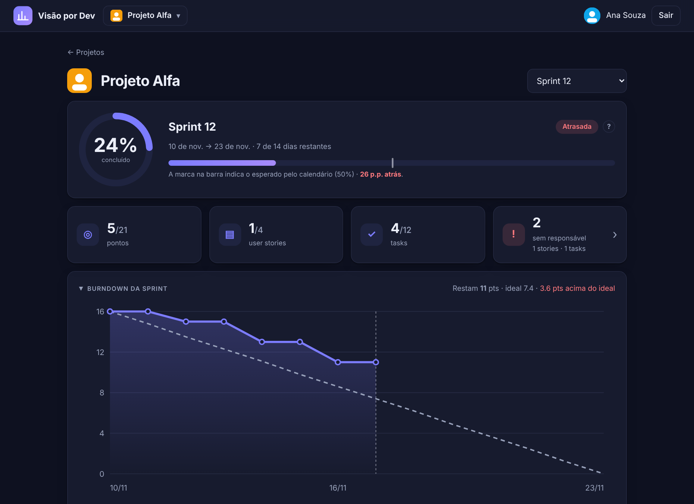
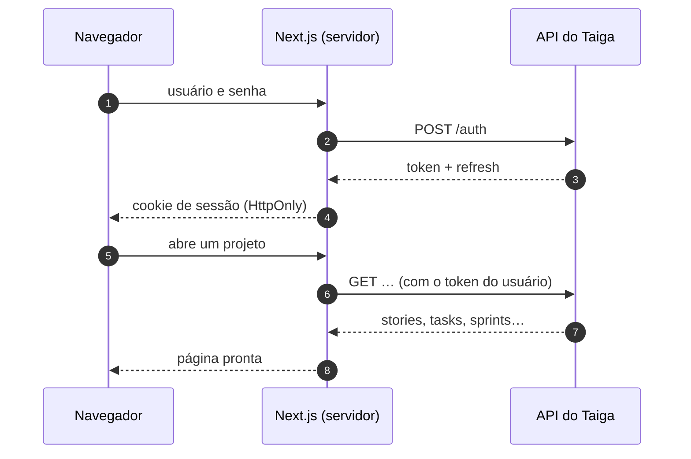

<div align="center">



# Taiga · Visão por Dev

**O que o Taiga não mostra: o andamento de cada pessoa do time, sprint a sprint — e o fluxo dos projetos Kanban.**

[](https://nextjs.org)
[](https://react.dev)
[](https://www.typescriptlang.org)
[](https://docs.taiga.io/api.html)


[Funcionalidades](#-funcionalidades) ·
[Começando](#-começando) ·
[Configuração](#-configuração) ·
[Como funciona](#-como-funciona) ·
[Critérios](#-critérios-dos-indicadores) ·
[Roadmap](#-roadmap)

<br />



</div>

<br />

## ✨ Por que existe

O Taiga é ótimo para organizar o trabalho, mas responder perguntas como *"quem está com o quê?"*, *"quem está impedido?"* ou *"essa sprint vai fechar no prazo?"* exige abrir quadro por quadro. Este projeto lê a API do Taiga e monta essas visões — **sem alterar nada no Taiga**.

Cada pessoa entra com o **próprio login do Taiga** e só enxerga os projetos de que já participa.

## 🧭 Funcionalidades

### Visão da sprint (projetos Scrum)

- **Ritmo da sprint** — progresso real contra o esperado pelo calendário, com selo *Acima do ritmo*, *No ritmo*, *Atrasada* ou *Fechada* e a diferença em pontos percentuais.
- **Burndown** do próprio Taiga, recolhível, com o resumo de quantos pontos a sprint está acima ou abaixo do ideal.
- **Um card por desenvolvedor**: progresso, pontos, tasks, itens em aberto e faixa vermelha 🚧 para quem está envolvido em **histórias com impedimento**.
- **Sem responsável**: o que ninguém assumiu, com a lista clicável.
- **Seletor de sprint** e **seletor de projeto** no topo (com busca e logos).
- Ícone **?** que explica cada critério com os números da sprint atual.

### Detalhe de cada pessoa e de cada item

- Página do dev com as stories e tasks agrupadas por status, e etiqueta de **bloqueada**.
- **Modal** com descrição em **Markdown renderizado** (tabelas, checklists, código, imagens), tasks da story, comentários e anexos.
- **Galeria de anexos** com visualizador: setas, teclado, deslize no celular e miniaturas.
- **Link ↗ para o item no próprio Taiga**, em todas as listas.

<div align="center">

</div>

### Projetos Kanban

Projetos sem o módulo Scrum (ou sem nenhuma sprint) ganham uma visão de **fluxo**, em janelas de 14, 28, 56 ou 84 dias:

- **Quadro** por coluna com totais e **limite de WIP** (em vermelho quando excedido).
- Em andamento, **impedidos**, **parados** há N dias, concluídos no período (vs. período anterior) e **tempo de entrega** (mediana e p85).
- **Vazão semanal** e cards por pessoa com os itens em andamento.
- Feito para quadros com **milhares de itens finalizados**: o total vem do cabeçalho `x-pagination-count` e só as páginas mais recentes são analisadas.

<div align="center">

</div>

### Conforto de uso

| | |
|---|---|
| ⭐ **Favoritos** | Estrela nos projetos; os favoritos sobem para o topo. Fica só no navegador de quem usa. |
| 🌗 **Claro e escuro** | Acompanha o tema do sistema. |
| 📱 **Responsivo** | Funciona no celular, sem rolagem horizontal. |
| 🔐 **Somente leitura** | Só faz `GET` na API (além do login). Não cria, edita nem apaga nada. |

<table>
<tr>
<td width="50%"></td>
<td width="50%"></td>
</tr>
<tr>
<td align="center"><sub>Login com a conta do Taiga</sub></td>
<td align="center"><sub>Projetos favoritos no topo</sub></td>
</tr>
</table>

<div align="center">

</div>

> As capturas usam o **modo demonstração** (dados fictícios). Veja [Testar sem um Taiga](#testar-sem-um-taiga).

## 🚀 Começando

### Requisitos

- **Node.js 18.17 ou superior** (testado com 22).
- Uma instância do **Taiga** com a API acessível (`https://…/api/v1`) e uma conta de usuário.

### Instalação

```bash
git clone https://github.com/ariribeiro/taiga-dahsboard.git
cd taiga-dahsboard
npm install
cp .env.example .env.local     # no Windows (CMD): copy .env.example .env.local
```

Edite o `.env.local` com o endereço da **API** do seu Taiga (sem `/api/v1` no final):

```bash
TAIGA_URL=https://taiga-api.suaempresa.com
# opcional, habilita os links "↗ Abrir no Taiga" (endereço do SITE, não da API):
TAIGA_WEB_URL=https://taiga.suaempresa.com
```

```bash
npm run dev      # http://localhost:3000
```

Entre com o seu usuário e senha do Taiga.

> 💡 **Não sabe o endereço da API?** Abra `https://SEU-TAIGA/conf.json` no navegador e procure a chave `"api"`. A API e o site do Taiga costumam ficar em subdomínios diferentes.

> 🪟 **Windows / PowerShell:** se o `npm` for bloqueado pela política de execução, use o CMD, `npm.cmd`, ou libere para o seu usuário com `Set-ExecutionPolicy -Scope CurrentUser -ExecutionPolicy RemoteSigned`.

### Testar sem um Taiga

O repositório inclui um **Taiga simulado** com um projeto Scrum (*Projeto Alfa*) e um Kanban (*Quadro Kanban*, com 300 itens finalizados):

```bash
npm run mock                 # sobe a API de mentira em http://localhost:9000
# em outro terminal, com TAIGA_URL=http://localhost:9000 no .env.local:
npm run dev
```

Entre com **qualquer usuário** e a senha **`senha`**.

<details>
<summary>Variáveis extras do simulador</summary>

| Variável | Efeito |
|---|---|
| `MOCK_DONE=800` | quantidade de itens finalizados no quadro Kanban |
| `MOCK_NO_ORDER=1` | faz a API recusar `order_by`, para testar o aviso de amostra parcial |
| `MOCK_LOG=1` | imprime cada requisição recebida (útil para contar chamadas) |

</details>

## 🔧 Configuração

Tudo em `.env.local` (veja o `.env.example`). **Só `TAIGA_URL` é obrigatória.**

| Variável | Padrão | Para quê |
|---|---|---|
| `TAIGA_URL` | — | Endereço da **API** do Taiga, sem `/api/v1`. |
| `TAIGA_WEB_URL` | *(vazio)* | Endereço do **site** do Taiga. Habilita os links `↗` para stories e tasks. Sem ela, os links ficam ocultos. |
| `DEV_ROLES` | Desenvolvedor, Analista de negócio e requisitos, Analista de UX, Analista de teste de qualidade, Arquiteto, Administrador de dados, Estagiário | Papéis do Taiga que ganham card, separados por vírgula. `*` mostra todos. Ignora maiúsculas, acentos e plural. |
| `BLOCKED_STATUS_REGEX` | `imped\|bloquead\|blocked` | Nomes de **status** que significam impedimento (além do bloqueio nativo do Taiga). |
| `KANBAN_STALE_DAYS` | `7` | Dias sem alteração para um item do Kanban contar como *parado*. |
| `LOGIN_MAX_FAILURES` / `LOGIN_WINDOW_MINUTES` | `8` / `15` | Tentativas de login com senha errada por usuário, dentro da janela, antes de bloquear. |
| `TRUST_PROXY` | `0` | `1` somente atrás de proxy reverso que informe o IP real (`X-Forwarded-For`). |
| `SESSION_IDLE_MINUTES` / `SESSION_MAX_HOURS` | `120` / `12` | A sessão expira após esse tempo sem uso, e dura no máximo isso desde o login. |
| `TAIGA_TIMEOUT_MS` / `TAIGA_MAX_CONCURRENCY` | `20000` / `8` | Tempo máximo de cada chamada ao Taiga e quantas podem ocorrer ao mesmo tempo. |

## 🔒 Como funciona



- **A senha passa só pelo servidor** e não é guardada. Os tokens ficam na **memória do servidor**; o navegador recebe apenas um cookie de sessão `HttpOnly` (`Secure` em produção).
- **Permissões do Taiga valem sempre**: o app usa o token da própria pessoa, então ninguém vê o que não poderia ver no Taiga.
- **Somente leitura**: nenhuma requisição altera dados no Taiga.
- **Freio de força bruta**: o login é bloqueado após poucas senhas erradas (por usuário e por IP), antes de consultar o Taiga.
- **Sessões com prazo**: expiram por inatividade e por duração máxima; um novo login encerra a anterior; em produção o cookie usa o prefixo `__Host-`.
- **Cabeçalhos de segurança**: CSP, proteção contra clickjacking, `nosniff`, `Referrer-Policy` e HSTS em produção.
- **Chamadas ao Taiga protegidas**: timeout, retentativas em falhas temporárias e limite de requisições simultâneas.
- **Markdown seguro**: descrições e comentários viram elementos React, e HTML embutido é sanitizado (sem scripts nem eventos).
- **Imagens e anexos** são carregados pelo **navegador** direto do Taiga; o navegador precisa alcançar o endereço da mídia.
- **O que fica guardado**: sessão (memória do servidor), lista de projetos (5 min), finalizados do Kanban (10 min) e **favoritos no `localStorage`** do navegador, por usuário.

## 📐 Critérios dos indicadores

O ícone **?** de cada página mostra isto dentro do app, com os números da sprint atual.

| Indicador | Como é calculado |
|---|---|
| **Progresso da sprint** | Pontos das stories **concluídas** ÷ pontos totais (sem pontos, conta stories). Uma story só conta quando fecha inteira. |
| **Esperado pelo calendário** | Fração dos dias já decorridos, de forma linear (fins de semana contam). |
| **Ritmo** | 🔵 *Acima* se real > esperado + **10 p.p.** · 🔴 *Atrasada* se real + 10 p.p. < esperado · 🟢 *No ritmo* no restante · ⚪ *Fechada*. |
| **Progresso do dev** | Pontos concluídos ÷ pontos das stories de que é responsável; sem pontos, tasks concluídas ÷ tasks. Pontos de stories compartilhadas são divididos igualmente. |
| **Impedimento** | Story **aberta** com status que combine com `BLOCKED_STATUS_REGEX` **ou** bloqueada no Taiga. Marca quem é responsável e quem só tem tasks nela. |
| **Sem responsável** | Stories + tasks da sprint que ninguém assumiu. |
| **Kanban: em andamento** | Colunas abertas, exceto a primeira (a fila). |
| **Kanban: parados** | Em andamento sem alteração há `KANBAN_STALE_DAYS`+ dias (pela data da última modificação). |
| **Kanban: tempo de entrega** | Da criação à conclusão dos itens concluídos no período; mediana e percentil 85. |

> ⚠️ Pontos são estimativas do time e papéis diferentes não são comparáveis entre si. Use os indicadores para **conversar sobre o fluxo**, não para ranquear pessoas.

## 📡 Consumo da API

O app evita sobrecarregar o Taiga. Contagens aproximadas de requisições:

| Tela | Requisições |
|---|---|
| Página da sprint | ~6 (projeto, membros, sprints, stories, tasks, burndown) |
| Página do dev | ~5 |
| Abrir o modal de um item | ~5 (item, membros, histórico, tasks da story, anexos) |
| Kanban, 1ª visita (300 finalizados) | 12 |
| Kanban, visitas seguintes | 8 (finalizados em cache) |

A lista de projetos do cabeçalho fica em cache por 5 minutos. No Kanban, as colunas concluídas **não são baixadas por inteiro**: o total vem de `x-pagination-count` e são lidas no máximo 5 páginas de 100 itens.

<details>
<summary>Endpoints do Taiga usados</summary>

`POST /auth` · `POST /auth/refresh` · `GET /projects` · `/projects/{id}` · `/memberships` · `/milestones` · `/milestones/{id}/stats` · `/userstories` · `/userstories/{id}` · `/tasks` · `/tasks/{id}` · `/userstory-statuses` · `/users/{id}` · `/history/{userstory|task}/{id}` · `/{userstories|tasks}/attachments`

Os campos usados seguem a documentação oficial da API. Versões muito diferentes do Taiga podem exigir ajustes.

</details>

## 🗂️ Estrutura

```
app/
  page.tsx                      login
  projects/                     lista de projetos (favoritos)
  projects/[id]/                sprint (Scrum) ou visão de fluxo (Kanban)
  projects/[id]/devs/[userId]/  situação de uma pessoa na sprint
  api/login · api/logout        sessão
  api/item                      detalhes de story/task para o modal
  item-modal · lightbox · …     componentes de interface
lib/
  taiga.ts                      cliente da API (token, refresh, paginação)
  session.ts                    sessão em memória
  sprint.ts · metrics.ts        carga e cálculos da sprint
  kanban.ts · kanban-metrics.ts carga e cálculos do Kanban
  roles.ts · links.ts           papéis e links para o Taiga
scripts/mock-taiga.mjs          Taiga simulado para demonstração
docs/                           logotipo e capturas de tela
```

## 🏭 Produção

```bash
npm run build
npm start
```

- Sirva por **HTTPS** (proxy reverso). Em produção o cookie de sessão é `Secure` e não funciona em HTTP puro.
- As sessões ficam **em memória**: reiniciar o servidor desloga todo mundo, e só há suporte a **uma instância**. Para várias instâncias, troque o armazenamento em `lib/session.ts` por Redis.
- Atrás de um proxy reverso, defina `TRUST_PROXY=1` para o limite de tentativas usar o IP real de cada pessoa.
- `npm run dev` escuta só em `127.0.0.1`; não exponha o servidor de desenvolvimento na rede.

## ⚠️ Limitações conhecidas

- **Sprints fechadas usam o estado atual:** o Taiga não guarda uma "foto" do fechamento, então uma story concluída depois do fim da sprint aparece como entregue nela.
- **Burndown só no nível da sprint** (não por pessoa).
- **No Kanban, "parado" usa a última modificação**, e um comentário de outra pessoa reinicia a contagem. O tempo real em cada coluna exigiria o histórico de cada item.
- **Next.js 14 sem correções futuras:** o `npm audit` ainda aponta vulnerabilidades que só têm correção no Next 16 (mitigadas: otimizador de imagens desligado e servidor de desenvolvimento só local). A migração é a próxima prioridade.
- **Não há testes automatizados** ainda; a validação foi feita com o Taiga simulado e na prática.

## 🔭 Roadmap

- [ ] **Perfil do dev ao longo das sprints** — tendência de entrega, estimada em ~2 requisições por sprint.
- [ ] **Fluxo acumulado (CFD) e tempo por coluna** no Kanban (exige guardar dados no servidor).
- [ ] Sessões em **Redis** para múltiplas instâncias.
- [ ] Testes automatizados para as regras de cálculo.

A lista completa de melhorias de arquitetura e segurança, com prioridades e esforço, está em [`docs/MELHORIAS-PENDENTES.md`](docs/MELHORIAS-PENDENTES.md).

---

<div align="center">
<sub>Feito com Next.js, React e TypeScript. Projeto independente, sem vínculo com o Taiga.</sub>
</div>
