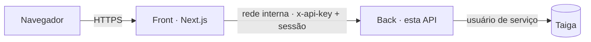

# Visão por Dev — API (back)

API do **Visão por Dev**. Ela consulta o Taiga com um **usuário de serviço**, aplica as regras de negócio (papéis, métricas de sprint e de Kanban) e entrega ao front os dados **já calculados**. O front (repositório `taiga-dev-view-front`) só desenha a tela.



- A API **não é exposta** fora do cluster (sem `Route`): só o front a alcança.
- **Pessoas** continuam entrando com usuário e senha do Taiga, mas isso serve **apenas para provar quem são**: o token delas é descartado na hora. Todas as consultas usam o token do usuário de serviço.
- O que cada pessoa pode ver é decidido **aqui**: só projetos em que ela tem o papel “Servidor Dirti/Fiscal” (veja `isAllowedRole` em `src/infra/taiga.ts`).

## Usuário de serviço

1. No Taiga, crie um usuário dedicado (ex.: `svc-taiga-dev-view`), com senha forte, que **não** seja de uma pessoa.
2. Adicione-o como **membro** de cada projeto que o painel deve mostrar, com um papel **somente leitura** (visualizar projeto, sprints, stories, tasks, membros e anexos). Quem não for membro não aparece no painel, mesmo que a pessoa tenha o papel certo.
3. Informe `TAIGA_SERVICE_USER` e `TAIGA_SERVICE_PASSWORD` (Secret do OpenShift, nunca no repositório).

A API entra com esse usuário sob demanda e **renova o token sozinha** (refresh e, se falhar, novo login). Se a senha for recusada, os dados respondem `503 SERVICE_AUTH` e o erro aparece no log; as pessoas continuam conseguindo entrar.

> ⚠️ Como o usuário de serviço enxerga mais do que cada pessoa, **toda rota confere o papel da pessoa no projeto** e o detalhe de item confere que ele pertence ao projeto informado. Qualquer rota nova que receba um id de projeto deve passar por `guardProject()` em `src/routes/guards.ts`.

## Rodando localmente

```bash
npm install
cp .env.example .env.local      # ajuste TAIGA_URL e o usuário de serviço
npm run dev                     # http://localhost:8080
```

Sem um Taiga de verdade, use o simulador (aceita qualquer usuário com a senha `senha`):

```bash
npm run mock                    # Taiga simulado em http://localhost:9000
TAIGA_URL=http://localhost:9000 TAIGA_SERVICE_USER=svc TAIGA_SERVICE_PASSWORD=senha npm run dev
```

## Configuração

| Variável | Padrão | Para quê |
|---|---|---|
| `TAIGA_URL` | — (**obrigatória**) | Endereço da API do Taiga, sem `/api/v1`. |
| `TAIGA_SERVICE_USER` / `TAIGA_SERVICE_PASSWORD` | — (**obrigatórias**) | Usuário de serviço. |
| `INTERNAL_API_KEY` | *(vazia)* | Se definida, toda rota (exceto `/healthz` e `/readyz`) exige o cabeçalho `x-api-key` igual a ela. **Use em produção.** |
| `TRUST_PROXY` | *(vazio)* | `1` = confia no `X-Forwarded-For` enviado pelo front (IP real do cliente para o freio de login). Só ligue se a API for inacessível a outros clientes. |
| `TAIGA_WEB_URL` | *(vazio)* | Site do Taiga, para os links “Abrir no Taiga”. |
| `PORT` / `LOG_LEVEL` | `8080` / `info` | Porta e nível do log (JSON, uma linha por evento). |
| `DEV_ROLES`, `BLOCKED_STATUS_REGEX`, `KANBAN_STALE_DAYS` | veja `.env.example` | Regras de exibição e de métricas. |
| `LOGIN_MAX_FAILURES` / `LOGIN_WINDOW_MINUTES` | `8` / `15` | Freio de força bruta no login. |
| `SESSION_IDLE_MINUTES` / `SESSION_MAX_HOURS` | `120` / `12` | Expiração da sessão. |
| `TAIGA_TIMEOUT_MS` / `TAIGA_MAX_CONCURRENCY` | `20000` / `8` | Tempo máximo e paralelismo das chamadas ao Taiga. |

Para um Taiga com certificado de CA interna, monte a CA e defina `NODE_EXTRA_CA_CERTS`.

## Contrato da API

Detalhes e exemplos de payload em [`docs/API.md`](docs/API.md). Resumo (a sessão vai em `Authorization: Bearer <sid>`):

| Rota | Descrição |
|---|---|
| `GET /healthz`, `GET /readyz` | Sondas (sem chave). `readyz` = 503 se faltar configuração. |
| `POST /auth/login` | `{username, password}` → `{sid, maxAge, user}`. Erros: 400, 401 `CRED`, 429 `LIMITE`, 502 `REDE`/`CERT`, 503 `CONFIG`. |
| `POST /auth/logout` | Encerra a sessão (204). |
| `GET /me` | Quem está logado. |
| `GET /projects[?cache=1]` | Projetos em que a pessoa tem o papel permitido. |
| `GET /projects/:id/sprint[?sprint=&stats=1]` | Sprint, devs, ritmo e burndown (ou `kind:"kanban"`). |
| `GET /projects/:id/kanban[?days=]` | Quadro e métricas de fluxo. |
| `GET /items?kind=us\|task&id=&project=` | Detalhe de story/task. |

Erros têm sempre o formato `{"error": "CODIGO"}` e **nunca** devolvem detalhes internos. Respostas levam `Cache-Control: no-store`.

## Testes

```bash
npm test            # tipos + unitários + API (sobe o Taiga simulado e chama a API em memória)
```

Os testes de `tests/api` cobrem login, sessão, freio de força bruta, chave interna, usuário de serviço (renovação e falhas), controle de acesso por papel, parâmetros inválidos, anexos perigosos e falhas do Taiga (timeout, 503 intermitente, concorrência).

## Contêiner e OpenShift

```bash
docker build -t taiga-dev-view-back .
docker run --rm -p 8080:8080 --env-file .env.local taiga-dev-view-back
```

A imagem roda como usuário sem privilégios, com o sistema de arquivos só de leitura, compatível com a SCC `restricted` (UID aleatório, GID 0). Manifests em [`deploy/openshift/`](deploy/openshift): `ConfigMap`, `Secret` (modelo), `Deployment`, `Service` (sem `Route`) e `NetworkPolicy` (só o front acessa).

```bash
oc apply -f deploy/openshift/configmap.yaml
oc create secret generic taiga-dev-view-back --from-literal=TAIGA_SERVICE_USER=... --from-literal=TAIGA_SERVICE_PASSWORD=... --from-literal=INTERNAL_API_KEY="$(openssl rand -hex 32)"
oc apply -f deploy/openshift/deployment.yaml -f deploy/openshift/service.yaml -f deploy/openshift/networkpolicy.yaml
```

> **Uma réplica apenas.** Sessões e contadores de login ficam em memória; reiniciar o pod desloga todos. Para escalar, mover para Redis (item B de [`docs/MELHORIAS-PENDENTES.md`](docs/MELHORIAS-PENDENTES.md)).

`.gitlab-ci.yml`: tipos, testes, build e `npm audit`; na branch padrão gera a imagem com Kaniko e publica no registro do GitLab.

## Estrutura

```
src/
  server.ts              entrada (porta, encerramento gracioso)
  app.ts                 monta o Fastify: chave interna, tratamento de erros, registro das rotas
  routes/                camada HTTP: valida a entrada, confere sessão/acesso e chama os serviços
    guards.ts            sessão (requireSession) e papel no projeto (guardProject): usados em toda rota
    health · auth · projects · sprint · kanban · items
  services/              casos de uso: juntam várias consultas ao Taiga e as regras do domínio
    sprint · kanban · item-detail · meta
  domain/                regras puras, sem rede nem estado (fáceis de testar)
    metrics · kanban-metrics · roles · periods · item (tipos)
  infra/                 acesso ao mundo externo e estado em memória
    taiga.ts             cliente do Taiga + token do usuário de serviço
    session · ratelimit · limit · links · placeholder
scripts/mock-taiga.mjs   Taiga simulado (desenvolvimento e testes; fora da imagem)
tests/                   unitários e de API
deploy/openshift/        manifests
```

Dependências: `routes → services → domain` e `infra`; `domain` não importa de `routes` nem de `services`.
